<div align="center">

# PublicDROP: Admin Panel Guide

### by VoidProjects

*Every admin feature explained in simple words: what it does, how to use it, and how to read your server's health. For installer version 15. Screenshots use sample demo data.*

</div>

---

## Contents

1. [Welcome: Read This First](#1-welcome-read-this-first)
2. [Logging In and Out](#2-logging-in-and-out)
3. [Finding Your Way Around](#3-finding-your-way-around)
4. [Home: Your Daily Dashboard](#4-home-your-daily-dashboard)
5. [Server: Is My Website Healthy?](#5-server-is-my-website-healthy)
6. [Notify: Send Push Notifications](#6-notify-send-push-notifications)
7. [Controls: Change How Your Website Looks and Behaves](#7-controls-change-how-your-website-looks-and-behaves)
8. [Inbox: Movie Requests and Messages](#8-inbox-movie-requests-and-messages)
9. [Users: Your Signed-In People](#9-users-your-signed-in-people)
10. [Insights: Is Your Website Growing?](#10-insights-is-your-website-growing)
11. [Team: Who Can Use This Admin Panel](#11-team-who-can-use-this-admin-panel)
12. [Activity: The Admin Diary](#12-activity-the-admin-diary)
13. [Servers: The Video Servers Behind "Server 1, Server 2…"](#13-servers-the-video-servers-behind-server-1-server-2)
14. [Database: Supabase and Backups](#14-database-supabase-and-backups)
15. [API Keys: Movie Data (TMDB)](#15-api-keys-movie-data-tmdb)
16. [Account: Your Own Login](#16-account-your-own-login)
17. [Cheat Sheets](#17-cheat-sheets)

---

# 1. Welcome: Read This First

Welcome to the **PublicDROP Admin Panel**. This guide explains **every screen, button and number** in the panel, in plain words. You do not need to be technical. If you can use WhatsApp, you can use this panel.

> **NOTE** All screenshots in this guide use **sample demo data** (made-up people, numbers and e-mails) so that no real visitor information is shown. Your own panel will show your real numbers. Your admin panel was captured in its **Light theme**.

## How to use this guide

- Start with **Section 2** (logging in) and **Section 3** (finding your way around).
- Every other section matches **one tab** of the panel, in the same order as the left menu.
- Each screenshot has **red numbered circles**. The numbered list under the picture tells you what each circle is.
- Look for these coloured boxes:

> **WHAT IT DOES** A one-line summary of the screen.

> **TIP** A shortcut or a good habit.

> **WARNING** Something that can affect your visitors. Read before you press.

> **NOTE** Extra information that is good to know.

## The colour code used everywhere

The panel uses the same three colours for every health number. Learn them once and you understand the whole panel.

| Colour | Meaning | What you do |
|---|---|---|
| 🟢 **Green** | Good. Working normally. | Nothing. |
| 🟠 **Orange** | Slow, getting full, or one thing is not working. | Look at the details soon. |
| 🔴 **Red** | A problem. Visitors may be affected. | Act now. |

## The big picture

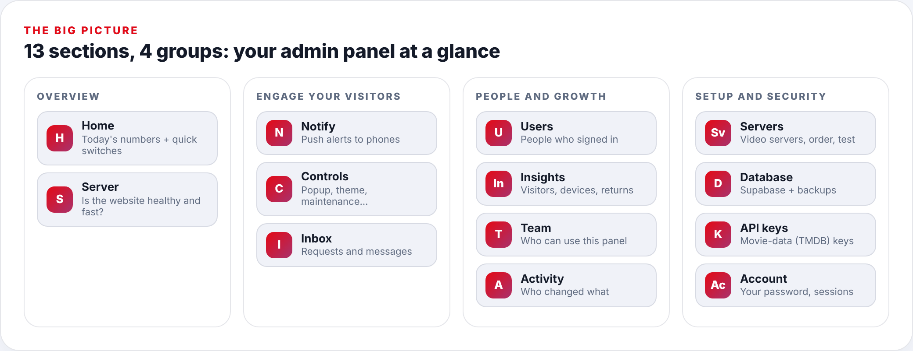

## Who can see what?

Your **role** decides which tabs you see. If a tab is missing from your menu, your role does not include it. That is normal and safe. Ask an **Owner** if you need more access.

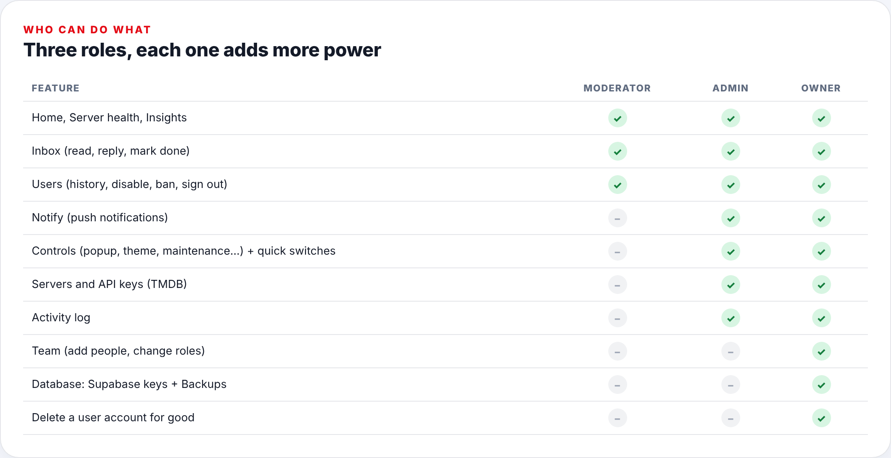

---

# 2. Logging In and Out

> **WHAT IT DOES** Keeps strangers out. Only people with a username and password can open the panel.

Open your website address followed by `/admin/` (for example `publicdrop.in/admin/`). You will see the sign-in card.

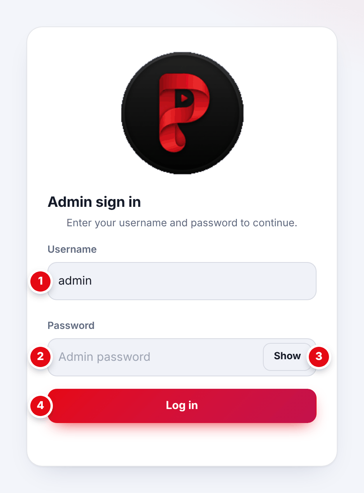

1. **Username.** Type your username. The first account created by the installer is called **admin** (an Owner). Team members use the username the Owner gave them.
2. **Password.** Type your password.
3. **Show / Hide.** Shows the password as text so you can check for typing mistakes. Press again to hide it.
4. **Log in.** Signs you in. You can also press **Enter**.

The little **sun / moon button** at the top-right of the sign-in screen switches between **Light** and **Dark** theme. The panel remembers your choice.

### Good to know about signing in

- You stay signed in for **30 days** on the same browser, unless you press **Log out**.
- After **too many wrong passwords** the panel says *"Too many wrong attempts. Wait 10 minutes."* Wait, then try again.
- If your account is **disabled** by an Owner, you cannot sign in.
- Every sign-in (and every wrong attempt) is saved in the **Activity log** (Section 12).

> **WARNING** If you see a yellow bar saying *"You are still using the default password"*, open **Account** right now and change it. Anyone who knows the default password could take over your website.

### Forgot the owner password?

Someone with access to the server can set a new password for the **admin** owner account by running this command on the server:

```
sudo pd-reset-password 'YourNewPassword'
```

The new password must be at least 8 characters. All admin devices are signed out when you do this.

---

# 3. Finding Your Way Around

> **WHAT IT DOES** Shows you where everything is, so you never feel lost.

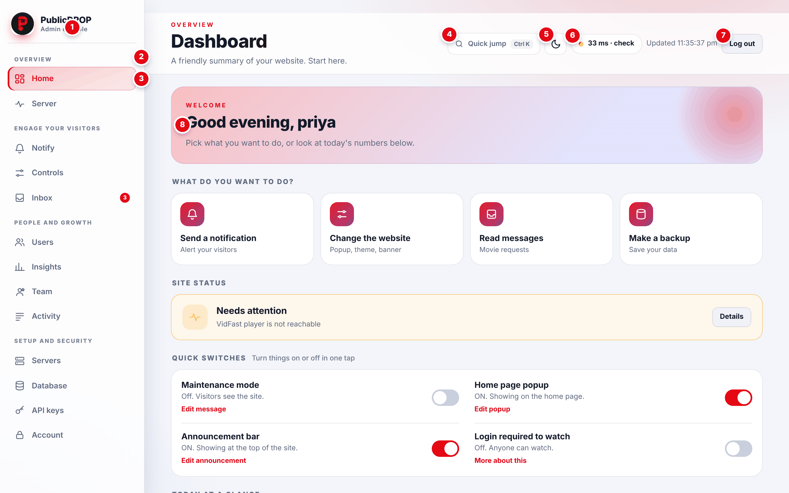

1. **Brand and role area.** The PublicDROP logo and the words "Admin console".
2. **Group titles.** The menu is sorted into four groups: *Overview*, *Engage your visitors*, *People and growth*, *Setup and security*.
3. **The open tab.** The tab you are in is highlighted. Red number badges (like on Inbox) show new items waiting for you.
4. **Quick jump.** Opens a search list so you can go to any tab by typing. Keyboard shortcut: **Ctrl + K** (Cmd + K on Mac).
5. **Light / Dark button.** Changes the look of the admin panel only (not your public website).
6. **Status pill.** A live health light for your website. Green = good. Click it to open the **Server** tab.
7. **Log out.** Signs you out of this browser.
8. **Page content.** The tab you opened. Under the page title there is always a one-line description.

## Quick jump (the fastest way to move)

Press **Ctrl + K**, or press the **Quick jump** button. Type a word like *backup* or *users*, then press **Enter**. Use **↑ ↓** to move and **Esc** to close.

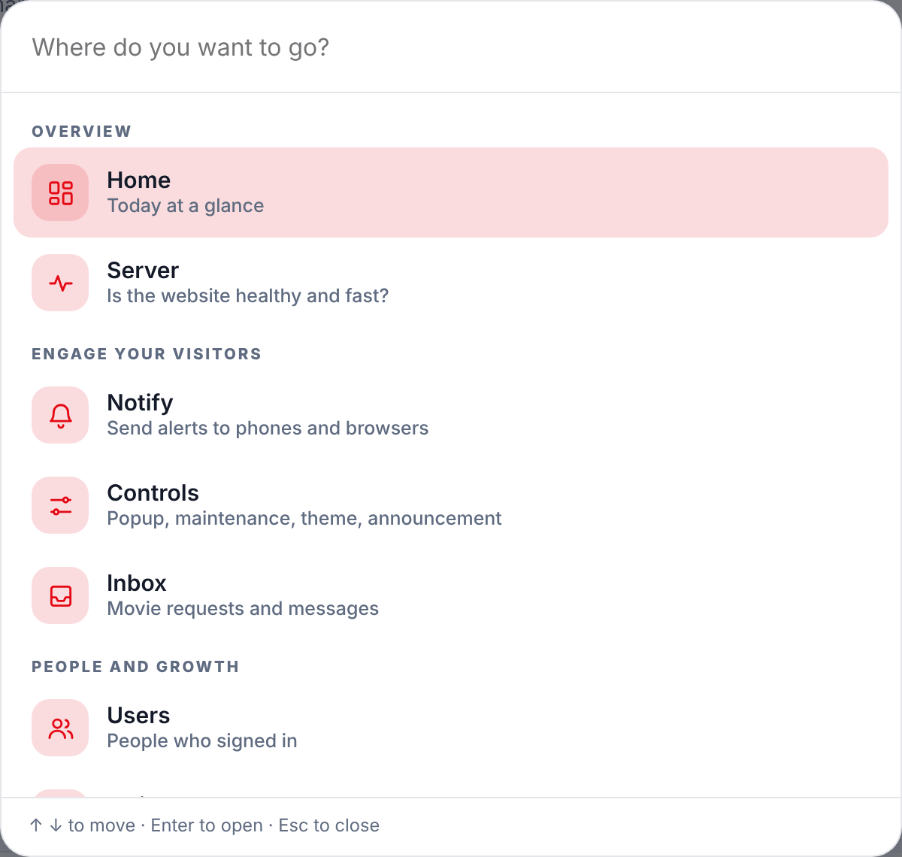

## The status pill (top right)

| What the pill says | Meaning |
|---|---|
| 🟢 **18 ms** | Website answers fast. All good. |
| 🟠 **620 ms · check** | Something needs attention. Click the pill to see what. |
| 🔴 **Problem** | The website or server is not answering. Click the pill now. |
| ⚪ **Checking…** | Waiting for the first result (a few seconds). |

## On your phone

On a phone the left menu becomes a **floating bar at the bottom** with four main buttons (**Home, Controls, Inbox, Users**) and a **More** button. Press **More** to open the full list of tabs.

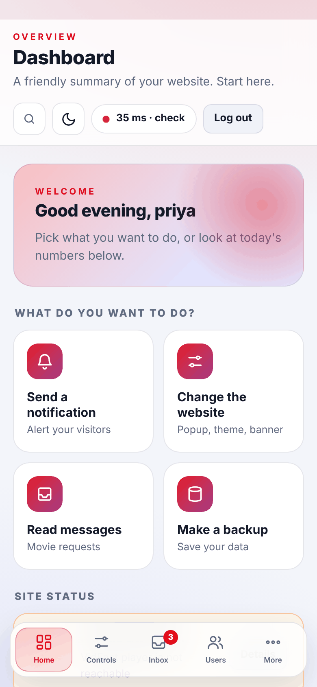

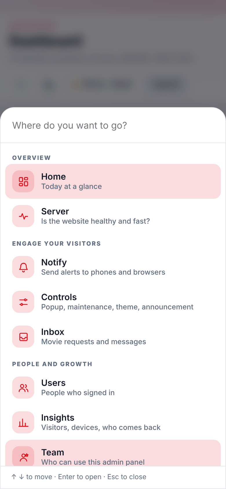

> **TIP** You can run your whole website from your phone: switch maintenance mode on, send a notification, or reply to a visitor.

---

# 4. Home: Your Daily Dashboard

> **WHAT IT DOES** A friendly summary of your website. **Start here every day.** It also holds the four most important on/off switches.
>
> **WHO CAN USE IT** Everyone. (The quick switches need Admin or Owner.)

The page refreshes **by itself every 5 seconds** while it is open. You never need to press reload.

## 4.1 Greeting and shortcut tiles

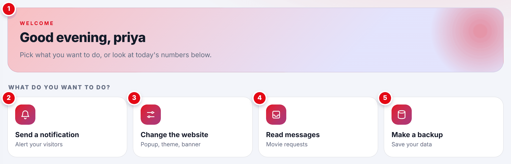

1. **Greeting.** Says *Good morning / afternoon / evening* and your username.
2. **Send a notification.** Opens **Notify**.
3. **Change the website.** Opens **Controls** (popup, theme, announcement).
4. **Read messages.** Opens **Inbox**.
5. **Make a backup.** Opens **Database**, right at the Backups box.

Tiles you are not allowed to use are hidden automatically.

## 4.2 Site status

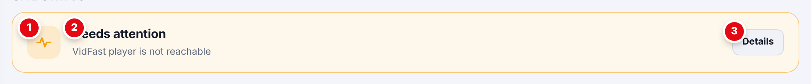

1. **Icon.** Its colour matches the state (green, orange or red).
2. **Title and reason.** For example *Everything looks good* or *Needs attention: VidFast player is not reachable*.
3. **Details.** Opens the **Server** tab (Section 5) with every number.

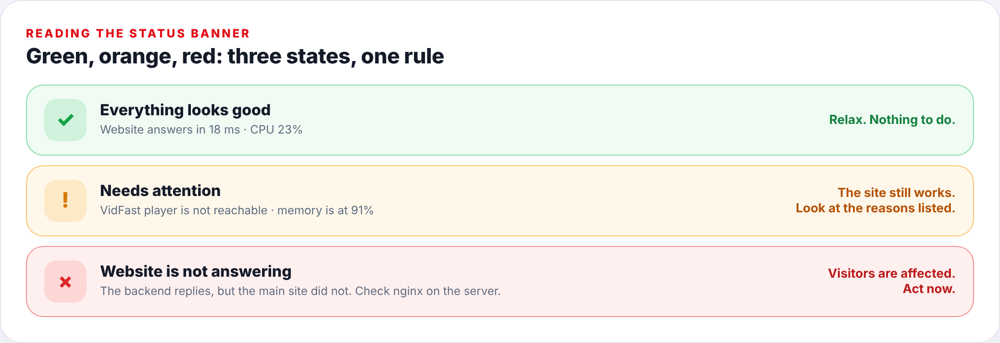

## 4.3 Quick switches

> **WHAT IT DOES** Turn four things on or off with **one tap**, without opening Controls.

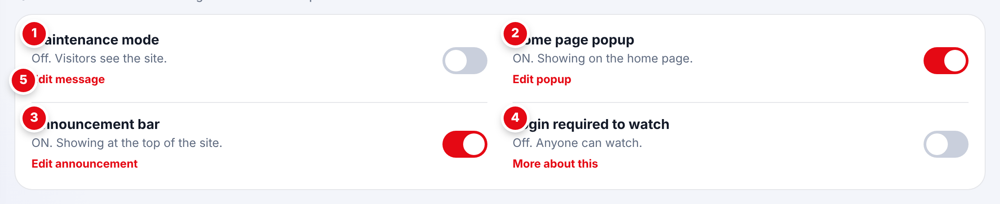

1. **Maintenance mode.** Covers the whole website with your "be right back" screen. The panel asks *"Are you sure?"* before turning it on.
2. **Home page popup.** Shows or hides the popup on the home page.
3. **Announcement bar.** Shows or hides the thin message bar at the top of the website.
4. **Login required to watch.** When ON, guests must sign in before any video plays. The panel asks you to confirm.
5. **Edit links** (small red text). Jump to the full settings for that switch.

Under each switch, a small line tells you the state:

| Text | Meaning |
|---|---|
| **Off.** | Not showing. |
| **ON.** Showing… | Visitors see it right now. |
| **Scheduled. Not showing right now.** | The switch is on, but you set a start/stop time and we are outside it. |

> **NOTE** A quick switch only flips the switch. It uses the text you already saved in **Controls**. If the popup or announcement has no text yet, the panel will take you to Controls to write it.

## 4.4 Today at a glance (the numbers)

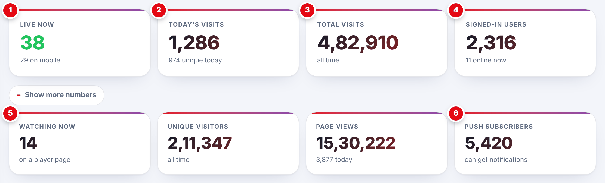

1. **Live now.** People on your website **at this moment**. The small line shows how many are on mobile.
2. **Today's visits.** Visits since midnight. Below it, *unique today* counts each person only once.
3. **Total visits.** Every visit since the panel started counting.
4. **Signed-in users.** Total registered people, and how many are **online now**.
5. **Watching now.** People currently on a **player page** (a video page).
6. **Push subscribers.** People who allowed notifications. This is how many phones can get your alerts.

Also under *Show more numbers*: **Unique visitors** (different people, all time) and **Page views** (every page opened, plus today's count).

> **NOTE** **Visit vs. page view.** A *visit* is one person arriving at the site. A *page view* is every page they open during that visit. One visit can have many page views.

## 4.5 Trends graph

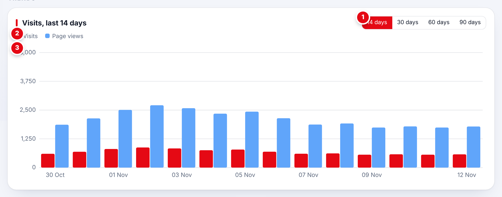

1. **Range buttons.** Choose **14, 30, 60 or 90 days**.
2. **Legend.** Red bars = **visits**. Blue bars = **page views**.
3. **The graph.** Hover (or tap) a bar to see the exact date and numbers.

## 4.6 Who is watching, and what is popular

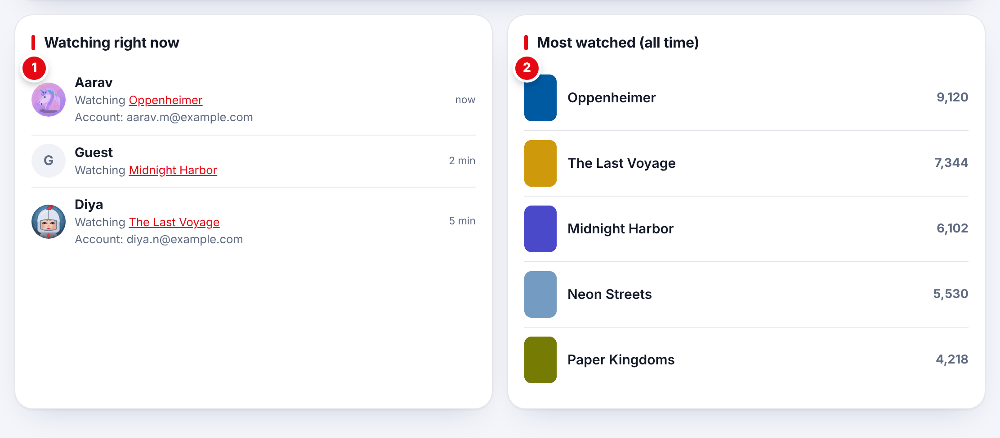

1. **Watching right now.** Each row shows the viewer's **avatar and profile name**, the **title** they are watching (tap it to open the title page) and how long ago they last pinged (*now* or *3 min*). People who are not signed in are shown as **Guest**.
2. **Most watched (all time).** The top titles with the number of views. Posters and names are loaded from TMDB.
# 5. Server: Is My Website Healthy?

> **WHAT IT DOES** Tells you, in real time, whether your website, your backend and your server machine are running well. It is your **website's heartbeat monitor**.
>
> **WHO CAN USE IT** Everyone who can open the panel.

**How it works:** while you are logged in and this browser tab is open, the panel checks your site **every 5 seconds**. When you log out or switch to another browser tab, the checks **stop**. Nothing is recorded or saved, and your visitors are never affected.

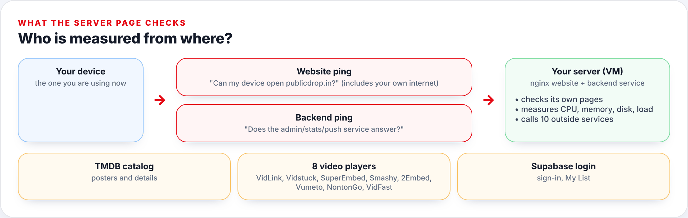

## 5.1 The big status banner and controls

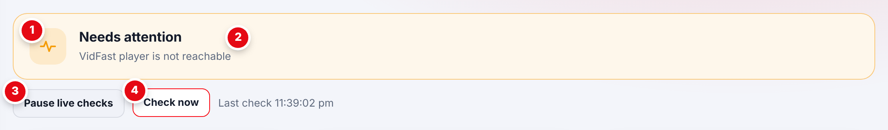

1. **Icon.** Green, orange or red, matching the state.
2. **Title and reason.** A plain sentence about what is wrong (or *Everything looks good*).
3. **Pause live checks / Resume.** Stops the 5-second checks (for example while you are fixing something). The banner then says *(live checks paused)*.
4. **Check now.** Runs a check immediately. The time of the last check is shown next to it.

### How the banner decides its colour

The banner looks at everything below and shows the **most serious** thing first.

| Banner | Why you see it | What to do |
|---|---|---|
| 🔴 **Can't reach your site** | Your device got no reply from the website **and** the backend (2 checks in a row). | Check **your own internet** first. Then check that the server is turned on. |
| 🔴 **Website is not answering** | The backend replies, but the main website does not. | Check **nginx** (the web server program) on your server and restart it if needed. |
| 🔴 **Server can't load its own site** | The server tried to open its own home page and got an error code. | Check nginx and the website files on the server. |
| 🟠 **Needs attention** | The site works, but one or more of the items listed in the banner is not ideal. | Read the reasons, then open the cards below. |
| 🟢 **Everything looks good** | No problems found. | Nothing to do. |
| 🟠 **Backend needs the update** | The server stats feature is not installed yet. | Run the newest installer (`pd-install.sh`) once. |

The orange **Needs attention** banner lists reasons such as:

- *website is a bit slow* (ping 500 ms or more) or *very slow* (1200 ms or more)
- *backend is not answering*
- *CPU is at 93%*, *memory is at 91%*, *disk is 92% full* (any of them 90% or more)
- *server load is high* (more than **2 ×** the number of CPU cores)
- *VidFast player is not reachable* (any outside service that does not answer)

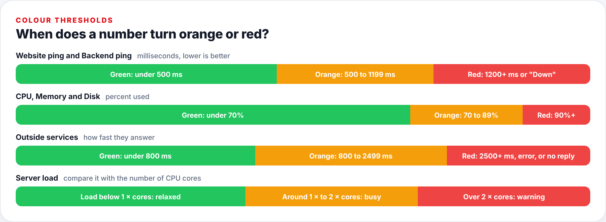

## 5.2 Website ping and Backend ping

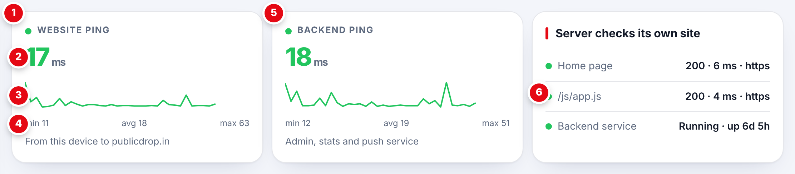

1. **Website ping card.** How fast your **own device** can open publicdrop.in.
2. **Big number.** The latest time in **milliseconds (ms)**. 1000 ms = 1 second. Lower is better. Green under 500, orange 500 to 1199, red 1200 or more. If two checks in a row fail, it shows **Down**.
3. **Mini graph (sparkline).** The last **40 checks** (about 3 minutes). A flat low line is healthy. Tall spikes mean the speed jumps around.
4. **min / avg / max.** The fastest, average and slowest of those last checks.
5. **Backend ping card.** The same idea for the **backend**: the part that runs the admin panel, statistics and push notifications.
6. **Server checks its own site.** The **server itself** opens your home page and `/js/app.js`. Each row shows the reply code (**200 = OK**), the time, and *https*. The last row shows the backend is **Running** and for how long (*up 6d 5h*).

> **TIP** **Ping measures from your device**, so your own slow Wi-Fi can make the ping look bad. Compare it with card 6: if the server's own check is tiny (a few ms) but your ping is high, the problem is probably **your internet**, not the server.

## 5.3 CPU, Memory, Disk and Load

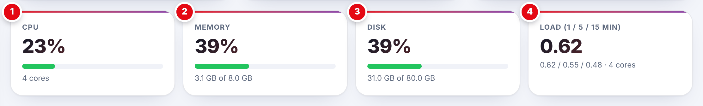

1. **CPU.** How hard the server's brain is working, in percent. Under the number you see how many cores (workers) it has.
2. **Memory.** How much RAM is in use (real use; memory Linux can free up is not counted). Shown as *3.1 GB of 8.0 GB*.
3. **Disk.** How full the storage is. A disk at 100% can break the whole site.
4. **Load (1 / 5 / 15 min).** How many jobs were waiting for the CPU on average over the last 1, 5 and 15 minutes. **Rule of thumb:** a load near the number of cores means the machine is fully busy. The panel warns when load is **more than 2 × the cores**.

| Meter | 🟢 Green | 🟠 Orange | 🔴 Red |
|---|---|---|---|
| CPU, Memory, Disk | under 70% | 70% to 89% | 90% or more |

## 5.4 Outside services and This machine

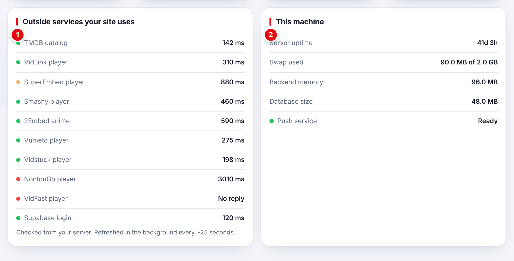

1. **Outside services your site uses.** Your site depends on **10 other services**. The server contacts each one and shows how fast it answers. They are refreshed in the background about **every 25 seconds**.
2. **This machine.** Extra details about the server: **uptime** (how long since the last restart), **swap used** (emergency memory on disk; a lot of swap means RAM is too small), **backend memory**, **database size**, and whether the **Push service** is *Ready* or *Not installed*.

### What each outside service does

| Service | Why your site needs it | If it is down |
|---|---|---|
| **TMDB catalog** | Movie and series posters, names and details | Rows and posters may not load |
| **VidLink, SuperEmbed, Smashy, 2Embed anime, Vumeto, Vidstuck, NontonGo, VidFast** | The video servers that actually play movies | That one server fails. Others still work. |
| **Supabase login** | Visitor sign-in, My List, Continue Watching | People cannot sign in |

| Reading | Meaning |
|---|---|
| 🟢 Under 800 ms | Fast |
| 🟠 800 to 2499 ms | Slow |
| 🔴 2500 ms or more, **Error 503**, or **No reply** | Down or very slow |

> **NOTE** Any reply that is not a server error (below 500) counts as "reachable". A service showing **No reply** did not answer within 5 seconds.

> **TIP** If one **video player** is red, go to the **Servers** tab (Section 13), press **Run ping test**, and move that server lower or switch it off. Visitors will not even notice.

## 5.5 VM health history

> **WHAT IT DOES** Shows how CPU, Memory and Disk changed over time, so you can spot trouble **before** it happens.

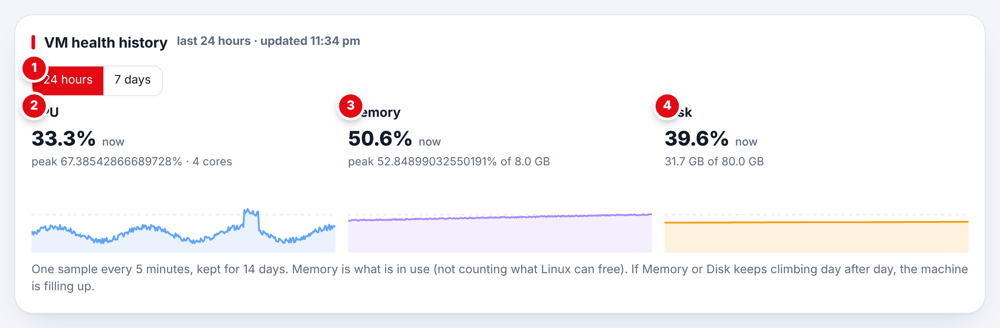

1. **24 hours / 7 days.** Pick the time window.
2. **CPU graph.** Big number is *now*. *Peak* shows the highest moment in the period. Short peaks are normal.
3. **Memory graph.** If this line **keeps climbing day after day**, something is using more and more memory.
4. **Disk graph.** If this line keeps climbing, the machine is slowly **filling up**. Free space or enlarge the disk before it reaches 90%.

One sample is saved **every 5 minutes** and kept for **14 days**. Right after a server restart you may see *Collecting data…* for a few minutes.

## 5.6 Browser errors

> **WHAT IT DOES** Shows script errors that happened inside **visitors' browsers**, grouped together, so you know if some page or device is breaking.

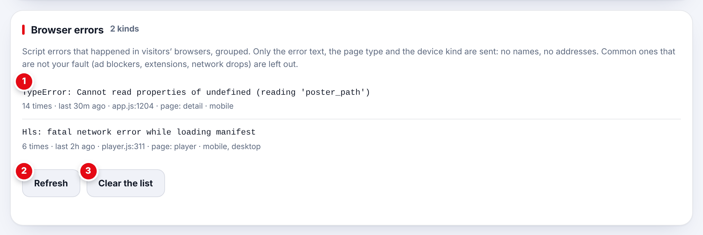

1. **The list.** Each row shows the error text, **how many times** it happened, when it **last** happened, the file, the **page type** (home, detail, player…) and the **device kind** (mobile / desktop).
2. **Refresh.** Loads the newest list.
3. **Clear the list.** Empties it (asks to confirm). Do this after you fix something, so you can see if the error comes back. Needs Admin or Owner.

**Your visitors' privacy is protected:** only the error text, page type and device kind are sent. No names, no e-mails, no addresses. Common harmless errors (ad blockers, browser extensions, network drops) are **left out automatically**.

> **TIP** *"No browser errors reported. That is a good sign."* is exactly what you want to see.
# 6. Notify: Send Push Notifications

> **WHAT IT DOES** Sends a short message to the **phones and browsers** of people who tapped "Allow notifications" on your site. Perfect for "New movie added!" or "We're back online".
>
> **WHO CAN USE IT** Admin and Owner.

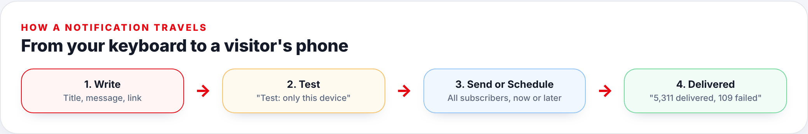

If you see an orange bar saying *"Push is not ready on the server (pywebpush missing)"*, notifications cannot be sent yet. Run the newest installer once to fix it.

## 6.1 Write and send

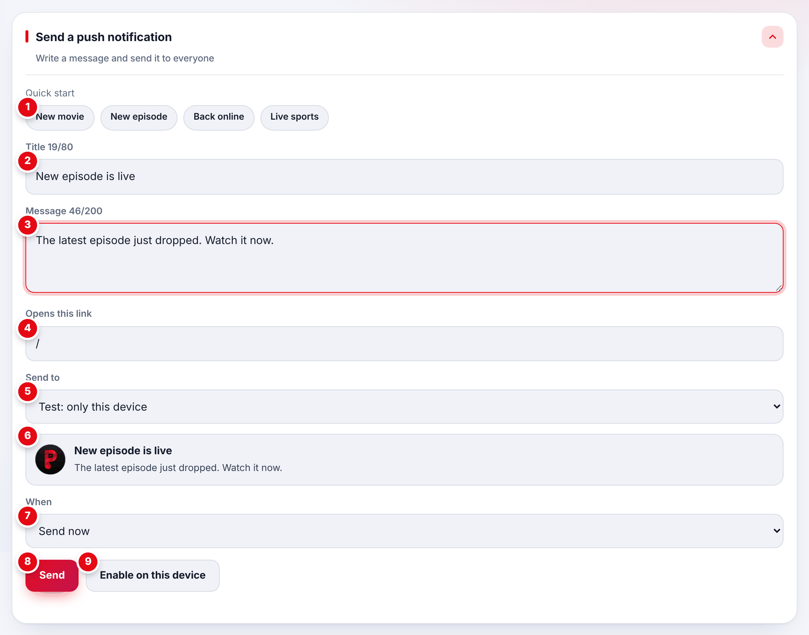

1. **Quick start.** Four ready-made messages: *New movie*, *New episode*, *Back online*, *Live sports*. Tap one to fill the title and message, then edit it if you like.
2. **Title** (max **80** characters). The bold first line of the notification. A counter shows how many characters you used.
3. **Message** (max **200** characters). The text under the title.
4. **Opens this link.** Where the visitor lands when they tap the notification. `/` = home page. `/#/watch/movie/872585` = a specific movie.
5. **Send to.** **Test: only this device** (safe, goes only to the phone/browser you are using) or **All subscribers**.
6. **Preview.** Shows how the notification will look.
7. **When.** **Send now** or **Schedule for later**.
8. **Send** (becomes **Schedule** if you chose later). Sending to everyone asks *"Send this to all N subscribers?"*.
9. **Enable on this device.** Lets **your own** browser receive notifications so you can run a test. The browser will ask for permission. Press **Allow**.

### The safe way to send (do this every time)

1. Press **Enable on this device** (only needed the first time on each device).
2. Keep **Send to = Test**, write your message, press **Send**.
3. Look at your phone. Does it look right? Does the link open the correct page?
4. Change **Send to** to **All subscribers** and press **Send**. Confirm.

> **WARNING** A notification to everyone **cannot be taken back**. Always test first, and read the title and message twice for typing mistakes.

## 6.2 Schedule a notification for later

Choose **Schedule for later** in **When** to show the extra boxes:

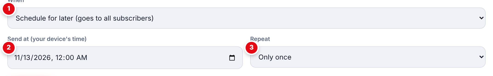

1. **When.** Set to *Schedule for later*. Scheduled messages always go to **all subscribers**.
2. **Send at.** Date and time, using **your device's clock**. It must be at least **1 minute** from now.
3. **Repeat.** **Only once**, **Every day** or **Every week**.

## 6.3 Scheduled and recent notifications

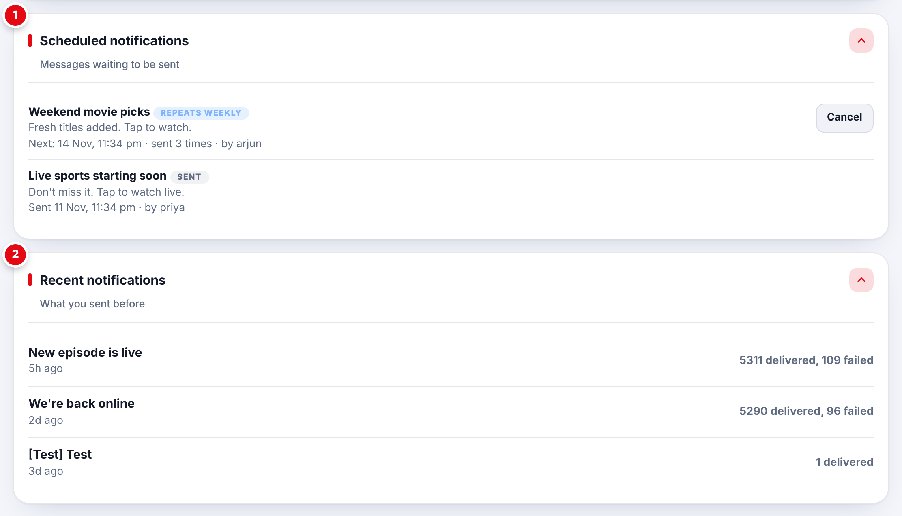

1. **Scheduled notifications.** Every planned message with a status tag:
   - **Scheduled** or **Repeats daily / weekly**: waiting for its time. Shows *Next:* date and how many times it was already sent. Press **Cancel** to stop it.
   - **Sent**: went out on time.
   - **Missed**: the server was off or busy at the planned time.
   - **Failed**: it could not be sent.
   - **Cancelled**: you stopped it.
2. **Recent notifications.** What you sent before, newest first. **[Test]** marks test sends. *"5,311 delivered, 109 failed"* shows how many devices got it.

> **NOTE** A few **failed** devices is normal: some people uninstall the app, clear their browser or turn off notifications. Every send is saved in the **Activity** log.

---

# 7. Controls: Change How Your Website Looks and Behaves

> **WHAT IT DOES** Seven control boxes that change your **public website** without touching any files. Visitors get your changes within about **30 seconds** (some on their next page load).
>
> **WHO CAN USE IT** Admin and Owner.

Each box is a **fold-out card**. Tap a card's title to open or close it. Every box has a short description under its title.

> **TIP** Many boxes have a **"Test on real site"** button. It opens your real website inside a phone or desktop frame and shows your **unsaved** changes. Visitors see nothing until you press **Save**.

> **NOTE** Wherever you can pick a start and stop time, the time uses **your device's clock**. Leave both empty and the item shows whenever its switch is ON.

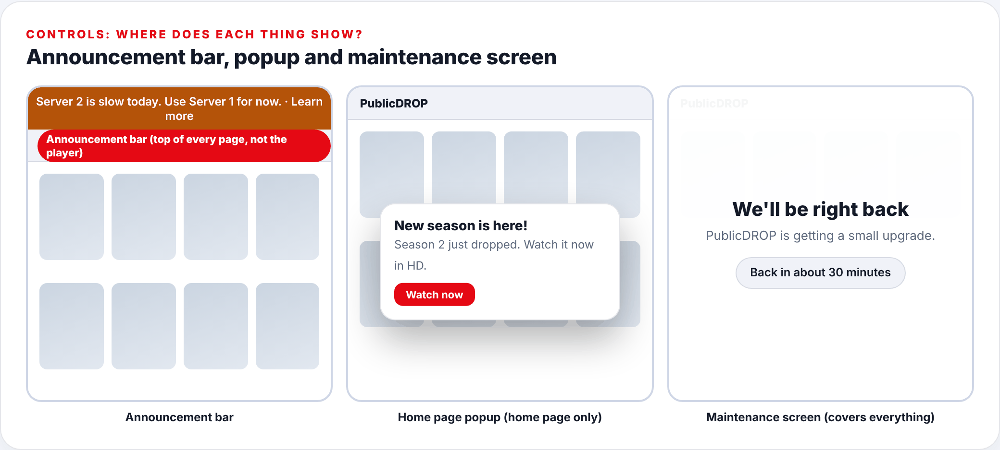

## 7.1 Site settings

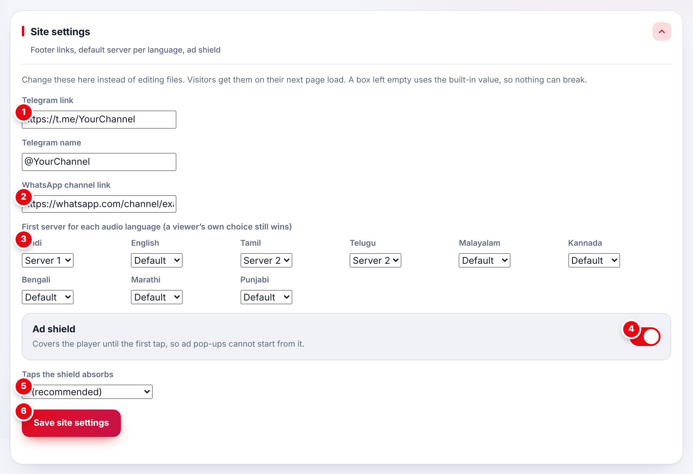

1. **Telegram link / Telegram name.** Your Telegram channel (for example `https://t.me/YourChannel` and `@YourChannel`). Shown in the website's footer and help areas.
2. **WhatsApp channel link.** Your WhatsApp channel link.
3. **First server for each audio language.** For Hindi, English, Tamil, Telugu, Malayalam, Kannada, Bengali, Marathi and Punjabi you can pick which **Server (1 to 6)** opens first. *Default* means "use the normal order". A viewer's own choice always wins.
4. **Ad shield.** Covers the player until the first tap, so ad pop-ups cannot start from the player.
5. **Taps the shield absorbs.** **0** = never covers the video, **1** = recommended, **2** or **3** = absorbs more taps.
6. **Save site settings.** Saves everything in this box. A box left empty uses the built-in value, so nothing can break.

## 7.2 Avatar sheets

> **WHAT IT DOES** Chooses which **picture style** visitors' profile avatars use. Nobody's chosen avatar number changes. Only the artwork behind the number.

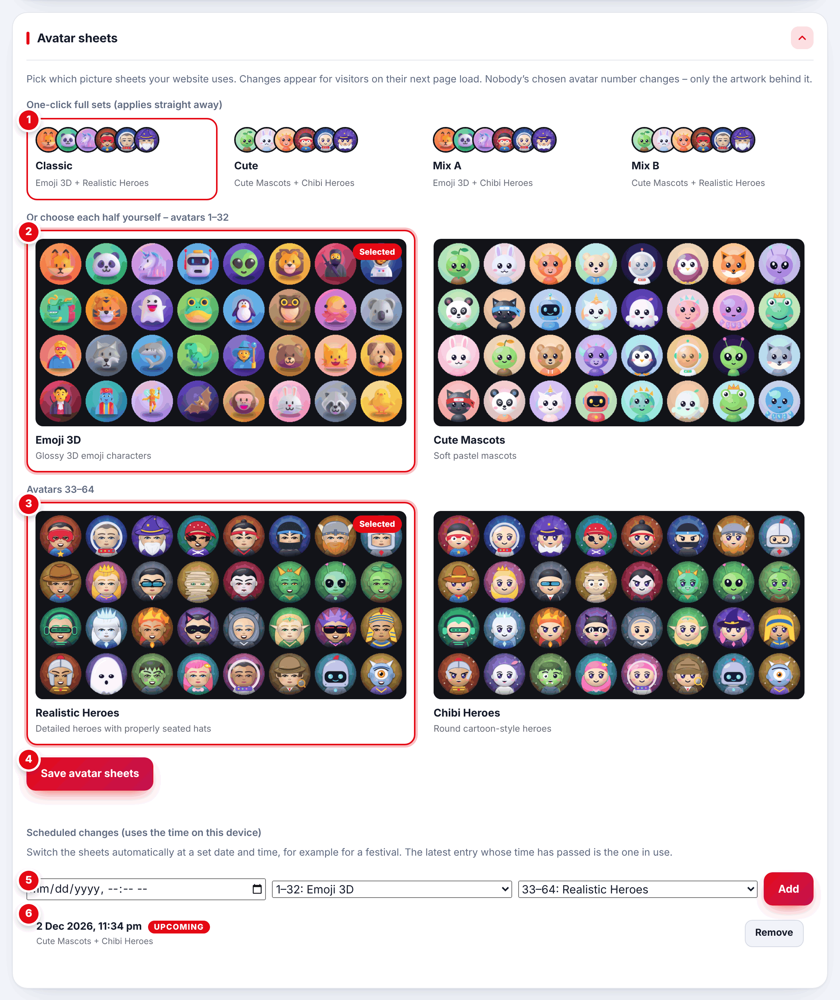

1. **One-click full sets.** Four ready combinations: **Classic** (Emoji 3D + Realistic Heroes), **Cute** (Cute Mascots + Chibi Heroes), **Mix A** (Emoji 3D + Chibi Heroes), **Mix B** (Cute Mascots + Realistic Heroes). Tapping one **applies straight away**.
2. **Avatars 1 to 32.** Pick **Emoji 3D** (glossy 3D emoji) or **Cute Mascots** (soft pastel mascots).
3. **Avatars 33 to 64.** Pick **Realistic Heroes** or **Chibi Heroes** (round cartoon style).
4. **Save avatar sheets.** Saves your separate half choices.
5. **Scheduled changes.** Pick a **date and time** and the sheets to switch to, then press **Add**. Great for festivals. You can keep up to **12** scheduled changes.
6. **Schedule list.** Shows each change with a tag: **in use now**, **upcoming** or **earlier**. The latest entry whose time has passed is the one in use. **Remove** deletes an entry.

## 7.3 Website theme

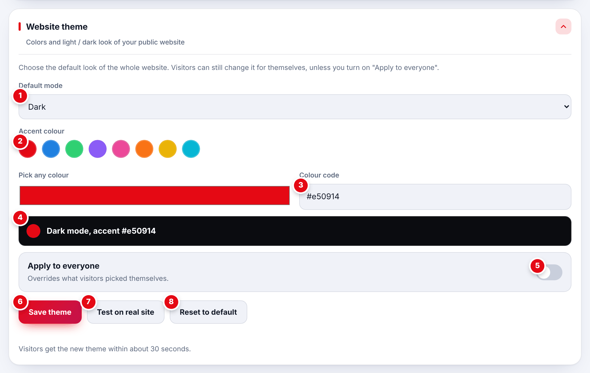

1. **Default mode.** **Dark** or **Light** for the whole public website.
2. **Accent colour swatches.** Eight ready colours (red, blue, green, purple, pink, orange, yellow, cyan). Tap one.
3. **Colour code / any colour.** Type your own code like `#1f80e0`, or use the colour picker beside it.
4. **Preview.** A small sample of your mode and colour.
5. **Apply to everyone.** OFF: visitors can still pick their own light/dark mode. ON: **your choice overrides everyone's**.
6. **Save theme.** Publishes it. Visitors get it within about **30 seconds**.
7. **Test on real site.** Preview on your real pages without saving.
8. **Reset to default.** Fills in dark mode and red (`#e50914`). You must still press **Save theme**.

## 7.4 Announcement bar

> **WHAT IT DOES** A thin coloured bar across the **top** of your website for short news, such as *"Server 2 is slow today."* It is **not shown on the player page**.

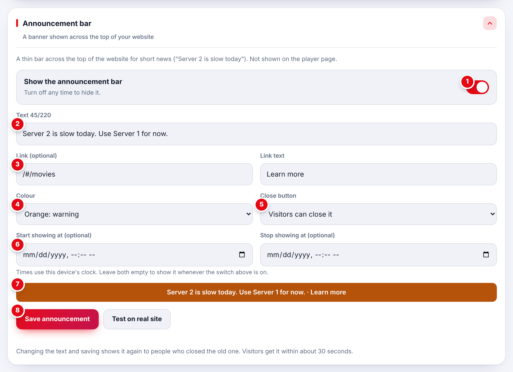

1. **Show the announcement bar.** The master switch.
2. **Text** (max **220** characters). The message.
3. **Link and Link text.** Optional. For example `/#/movies` with the text *Learn more* (max 30 characters).
4. **Colour.** **Blue** = news, **Green** = good news, **Orange** = warning, **Red** = problem.
5. **Close button.** *Visitors can close it* or *Always visible*.
6. **Start / Stop showing at.** Optional schedule.
7. **Live preview strip.** Shows exactly how the bar will look.
8. **Save announcement.** Publishes it. **Test on real site** is next to it.

> **TIP** If you change the text and save, people who closed the old message **will see the new one**.

## 7.5 Login required to watch

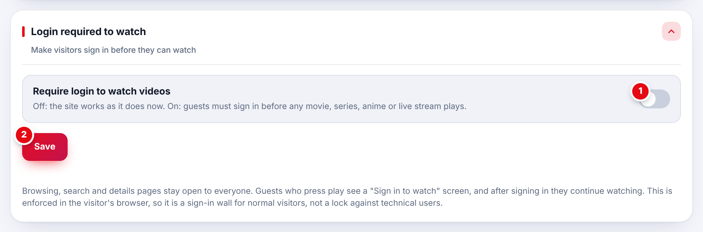

1. **Require login to watch videos.** **OFF** (normal): anyone can watch. **ON**: guests must sign in before any movie, series, anime or live stream plays.
2. **Save.** Asks you to confirm when you turn it ON.

Browsing, search and detail pages stay open to everyone. Guests who press play see a **"Sign in to watch"** screen, and after signing in they carry on watching.

> **NOTE** This is a **sign-in wall for normal visitors**. It happens in the visitor's browser, so it is not a lock against technical users.

## 7.6 Home page popup

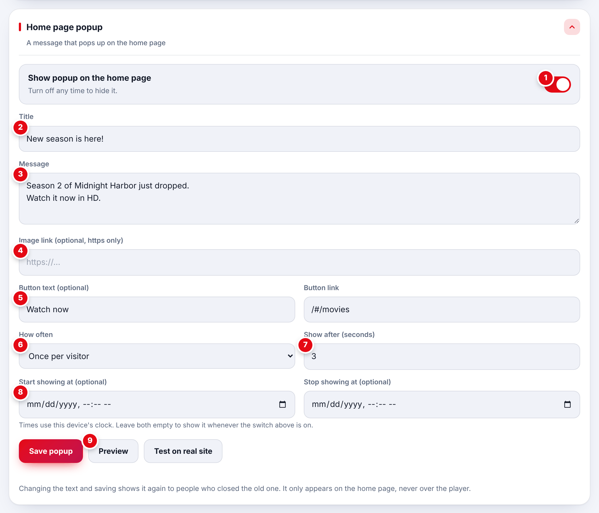

1. **Show popup on the home page.** Master switch.
2. **Title** (max 80 characters).
3. **Message** (max 600 characters). A new line starts a new paragraph.
4. **Image link** (optional, must start with `https`).
5. **Button text and Button link.** Optional. For example *Watch now* → `/#/movies`.
6. **How often.** **Once per visitor**, **Once a day** or **Every visit**.
7. **Show after (seconds).** Delay from 0 to 30 seconds after the home page opens.
8. **Start / Stop showing at.** Optional schedule.
9. **Preview** (simple preview), **Test on real site** (real pages) and **Save popup**.

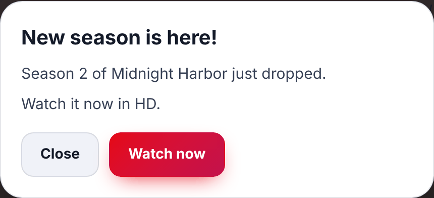

> **NOTE** The popup only appears on the **home page**, never over the player. If you change the text and save, people who closed the old popup see the new one.

## 7.7 Maintenance mode

> **WHAT IT DOES** Covers the **whole website** with a "we'll be right back" screen while you work.

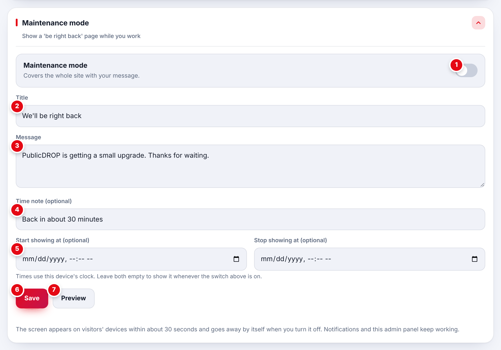

1. **Maintenance mode.** Master switch.
2. **Title** (max 80 characters).
3. **Message** (max 600 characters).
4. **Time note** (optional, max 60). For example *Back in about 30 minutes*.
5. **Start / Stop showing at.** Optional. Maintenance can switch on and off by itself.
6. **Save.** If maintenance is ON, the panel asks you to confirm first.
7. **Preview.** Shows the full screen visitors will see.

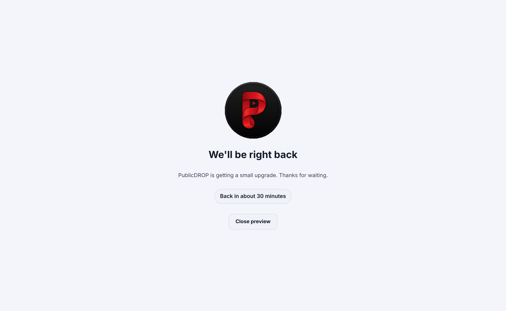

- The screen appears on visitors' devices within about **30 seconds** and **goes away by itself** when you turn it off.
- **You can still use the website while you are logged in** to this admin panel on this browser. An orange bar in this box reminds you when maintenance is ON.
- **Notifications and this admin panel keep working** during maintenance.

> **WARNING** Maintenance mode stops **all visitors**. Turn it off when you finish. On the Home tab, the **Maintenance mode** switch shows *ON. Visitors see the maintenance screen* whenever it is active.

---

# 8. Inbox: Movie Requests and Messages

> **WHAT IT DOES** Collects everything **signed-in visitors** send from **Request a Movie** and **Help and Support** on your website.
>
> **WHO CAN USE IT** Moderator, Admin and Owner.

A **red number badge** appears on the Inbox menu when something new arrives, and a pop-up message says *"New message in your Inbox."* The e-mail you see is the one on the visitor's account, checked by Supabase, so it is real.

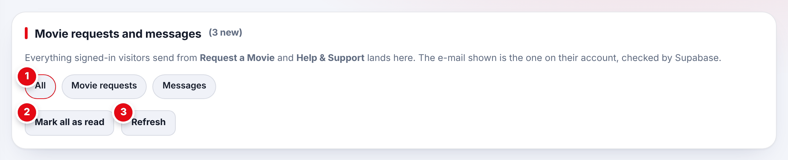

1. **Filter chips.** **All**, **Movie requests**, or **Messages**.
2. **Mark all as read.** Clears the "New" tags in one go.
3. **Refresh.** Loads the newest items.

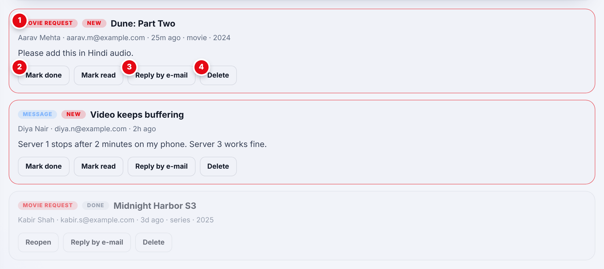

1. **Type and status tags.** **Movie request** or **Message**. A **New** tag (and a red outline) means you have not handled it. **Done** items look faded.
   - Each item also shows the visitor's name, e-mail, how long ago, and for movie requests the **type** (movie/series) and **year**.
2. **Mark done.** You finished it. It turns faded. Done items show **Reopen** instead. **Mark read** removes the "New" tag without finishing it.
3. **Reply by e-mail.** Opens your mail app with the visitor's address and a subject already filled in.
4. **Delete.** Removes it **for good** (asks to confirm).

> **TIP** Recommended routine: *New* → read it → add the movie or fix the problem → **Reply by e-mail** → **Mark done**.
# 9. Users: Your Signed-In People

> **WHAT IT DOES** Shows everyone who **signed in** to your website, how long they have watched, and lets you **disable, ban or sign out** problem accounts.
>
> **WHO CAN USE IT** Moderator, Admin and Owner. (Deleting an account is **Owner only**.)

Only people who **signed in** are listed. Other visitors are counted in your statistics but do not appear here.

## 9.1 Total watch time

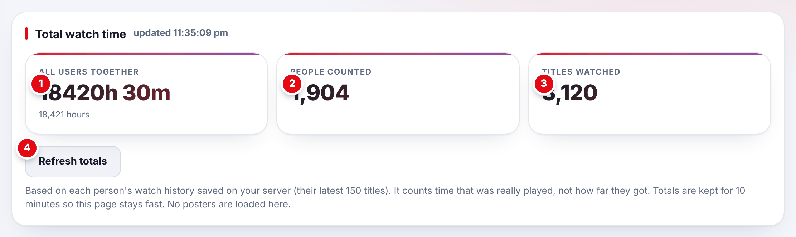

1. **All users together.** All the time everyone has really watched, shown as hours and minutes (and total hours underneath).
2. **People counted.** How many people are included.
3. **Titles watched.** How many different titles were watched.
4. **Refresh totals.** Recalculates now.

It counts **time that was really played**, not how far someone got. It is based on each person's saved history (their latest **150** titles). Totals are kept for **10 minutes** so this page stays fast.

## 9.2 Watch time by day and most watched titles

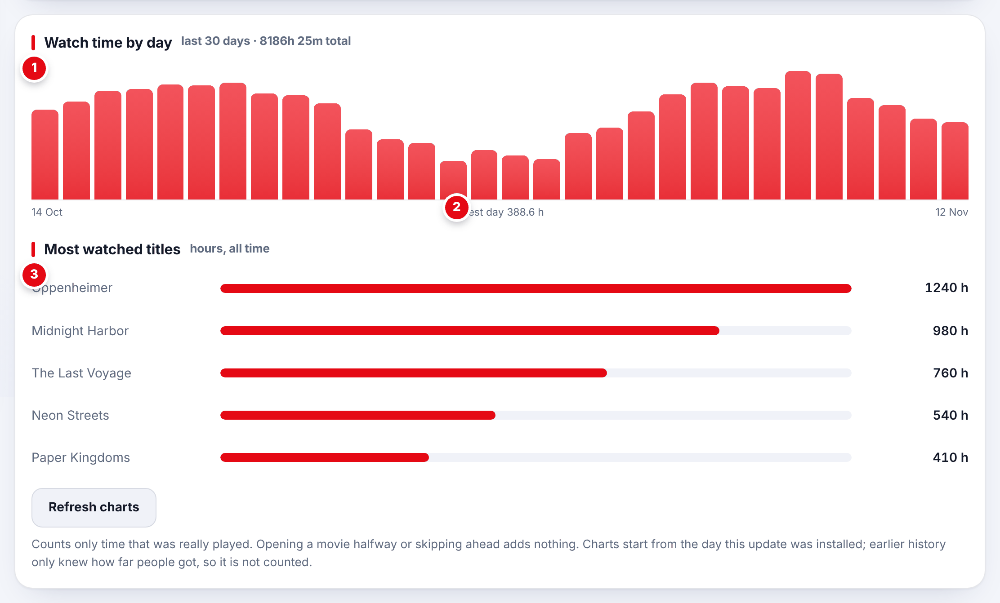

1. **Bars.** Hours watched **per day for the last 30 days**. Hover or tap a bar for the exact time.
2. **Tallest day.** The biggest bar's value, and the first and last dates under the graph.
3. **Most watched titles.** Hours watched per title, all time, with a bar for easy comparing.

> **NOTE** Opening a movie halfway or skipping ahead adds nothing. Only real playing time counts. Charts start from the day the update was installed.

## 9.3 The signed-in users list

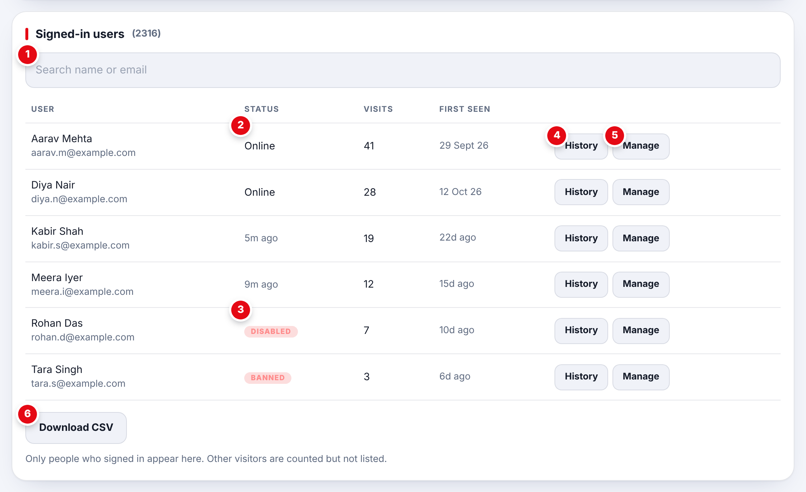

1. **Search box.** Type part of a name or e-mail to filter the list.
2. **Status column.** **Online** (active right now), or *how long ago* they were last seen (like *5m ago*).
3. **Disabled / Banned tags.** A red tag shows accounts you have blocked.
4. **History.** Opens that person's **watch history**.
5. **Manage.** Opens the action box (below).
6. **Download CSV.** Saves the list as a spreadsheet file with name, e-mail, status, visits, first seen and last seen.

### Watch history of one person

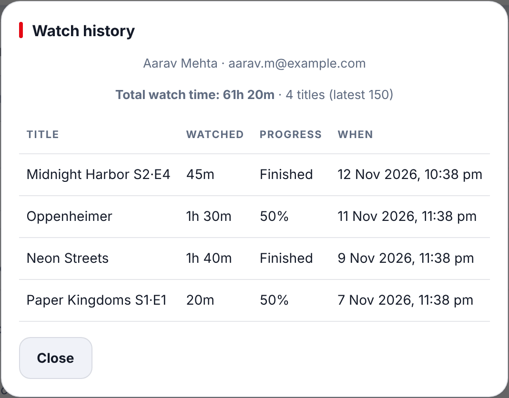

You see their **total watch time**, and a table of titles (series show *S2·E4*) with **Watched** time, **Progress** (*Finished* or a percentage) and **When**. It shows their latest 150 titles.

> **NOTE** Viewing someone's history is written in the **Activity log**, so everything is accountable.

### The Manage box

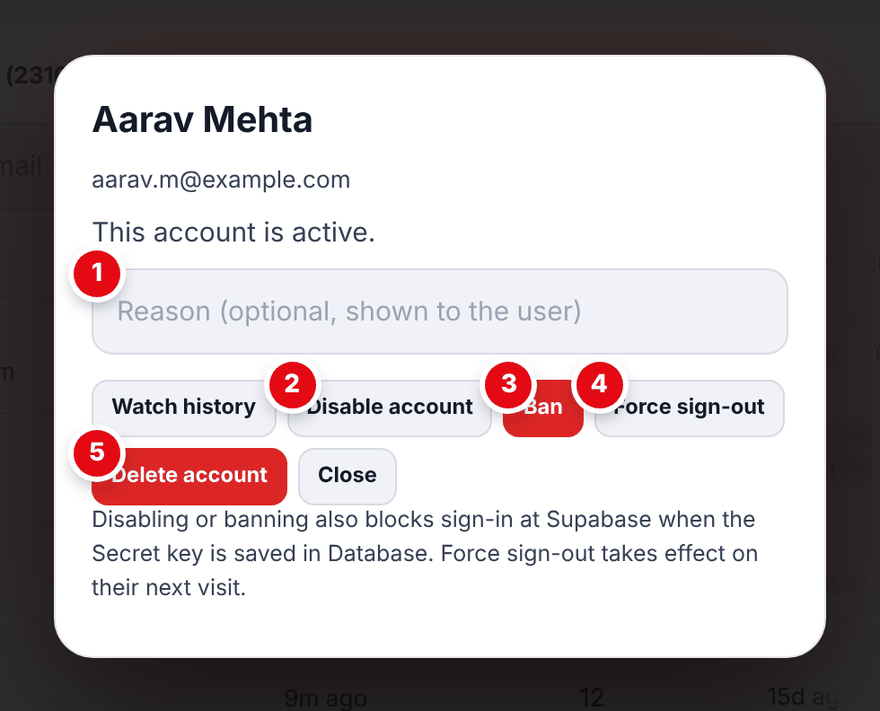

1. **Reason** (optional). Shown to the user if you disable or ban them.
2. **Disable account.** The person is signed out and **cannot sign in** until you press **Allow again**. Use for a temporary problem.
3. **Ban.** Like disable, but **stronger**: even if the account is deleted later, that **e-mail stays blocked**.
4. **Force sign-out.** Signs them out everywhere on their next visit. They can sign in again.
5. **Delete account** (**Owner only**). **Permanently** deletes the account and its saved list and progress. This **cannot be undone**.

If an account is already disabled or banned, the first button becomes **Allow again**.

> **WARNING** For *Disable* and *Ban* to stop sign-in at the source, the **Secret key** must be saved in **Database** (Section 14).

---

# 10. Insights: Is Your Website Growing?

> **WHAT IT DOES** Shows **where visitors come from**, how many come each day, whether they **come back**, and on what **devices**.
>
> **WHO CAN USE IT** Moderator, Admin and Owner.

## 10.1 Where visitors come from

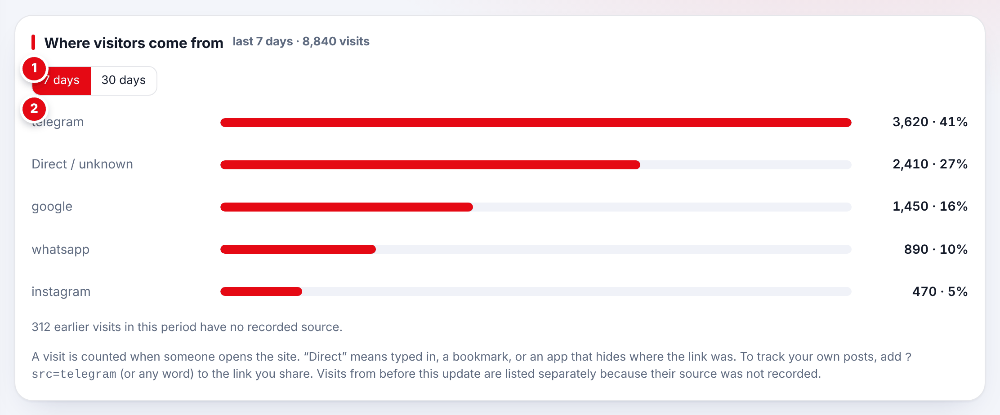

1. **7 days / 30 days.** Choose the time window.
2. **Source list.** Each row shows a source, its visits and its share. **Direct / unknown** means someone typed the address, used a bookmark, or came from an app that hides where the link was.

> **TIP** **Track your own posts!** Add `?src=telegram` (or any word) to a link you share, like `publicdrop.in/?src=telegram`. That word then appears here, so you learn which post or channel brings the most people.

Visits from before the update list their source as unknown and are shown as a separate line.

## 10.2 Most-used avatars

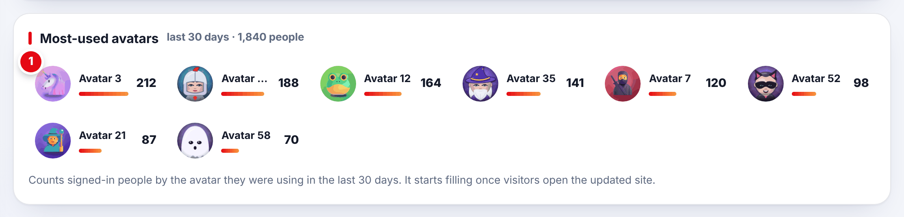

1. **Top avatars.** The 12 most used avatars among signed-in people in the **last 30 days**, with the number of people.

## 10.3 Visitors per day

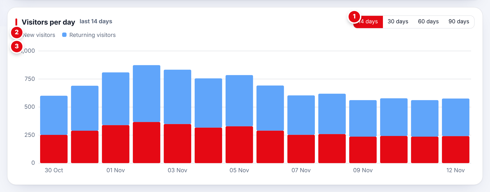

1. **Range buttons.** 14, 30, 60 or 90 days.
2. **Legend.** Red = **new** visitors (first time). Blue = **returning** visitors.
3. **Stacked bars.** Each bar is one day. The two colours add up to that day's visitors.

## 10.4 Do people come back?

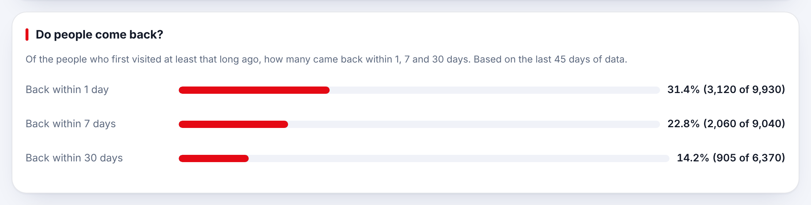

Three bars answer: *"Of the people who first visited at least that long ago, how many came back within **1**, **7** and **30** days?"* A higher percentage means visitors like your site. It is based on recent data, and says *Not enough data yet* until there is enough.

## 10.5 Devices

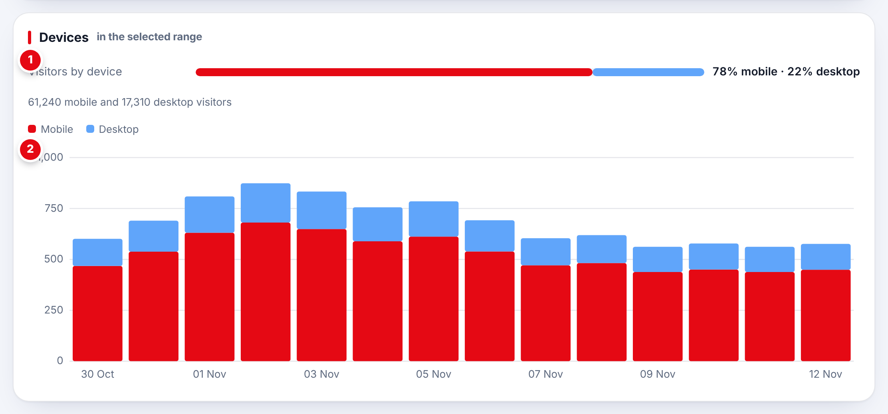

1. **Visitors by device.** One bar split into **mobile** (red) and **desktop** (blue), with percentages and counts.
2. **Per day.** The same split for each day.

> **TIP** If most visitors are on mobile, always **test your popups and announcements on the Phone view** (Controls → *Test on real site*).

---

# 11. Team: Who Can Use This Admin Panel

> **WHAT IT DOES** Add helpers and choose exactly how much they can do.
>
> **WHO CAN USE IT** **Owner only.**

## 11.1 The team list

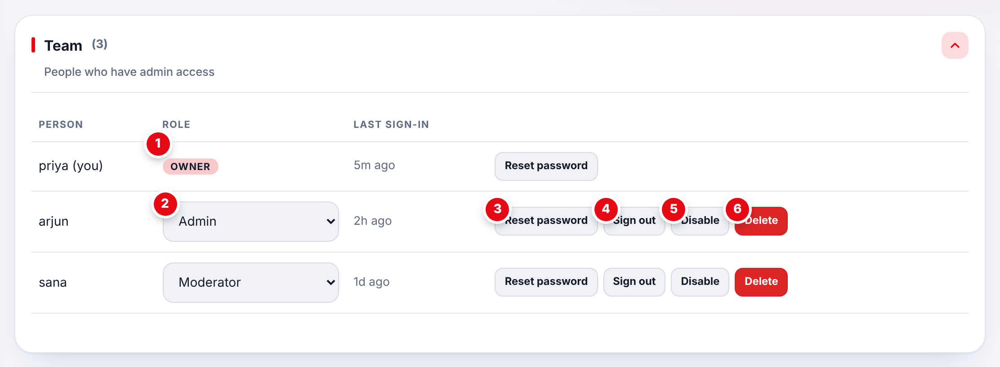

1. **Your own row.** Shows a role badge. You cannot change or disable **yourself**.
2. **Role menu.** Change someone to **Moderator**, **Admin** or **Owner**.
3. **Reset password.** Type a new password (at least 8 characters).
4. **Sign out.** Signs that person out of every device.
5. **Disable / Enable.** Blocks or allows their sign-in without deleting them.
6. **Delete.** Removes the team member (asks to confirm).

Changing a role, resetting a password or disabling someone **signs them out straight away**. There must always be **at least one active Owner**.

## 11.2 Add a team member

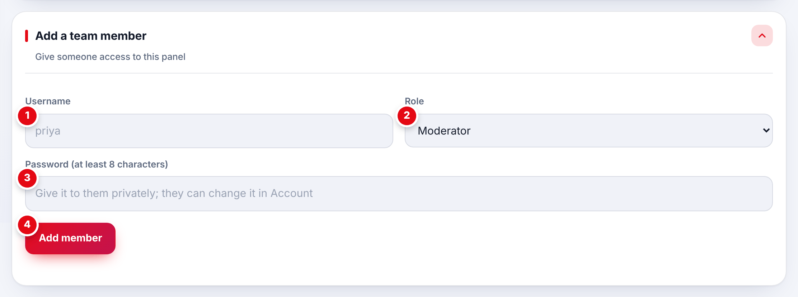

1. **Username.** Short, no spaces (max 30). The panel makes it lowercase.
2. **Role.** Moderator, Admin or Owner.
3. **Password.** At least **8 characters**. Give it to them **privately** (for example in a personal message). They can change it in **Account**.
4. **Add member.**

## 11.3 What each role can do


> **TIP** Give people the **lowest role** that lets them do their job. Most helpers only need **Moderator** (answer visitors) or **Admin** (run the website). Keep **Owner** for yourself and one trusted backup.

---

# 12. Activity: The Admin Diary

> **WHAT IT DOES** A record of **who signed in and what they changed**. If something odd happens, you can see who did it and when.
>
> **WHO CAN USE IT** Admin and Owner.


1. **Person filter.** *Everyone* or one team member.
2. **A normal row.** *When*, *Who* (and their role), and *What*. For example *Sent push notification: New episode is live → all 5420*.
3. **A failed sign-in.** Shown as *Failed sign-in* with *not signed in* instead of a role, and the **IP address** of the attempt. Several of these in a row can mean someone is guessing passwords.

- The **last 5000** entries are kept.
- Only **sign-in attempts** keep an IP address.
- Entries by *system* (marked **automatic**) are things the server did by itself, such as a scheduled notification.

### What gets recorded

| Group | Examples |
|---|---|
| **Sign-in** | Signed in, Failed sign-in, Signed out of every device, Changed own password |
| **Website settings** | Maintenance mode, Home popup, Theme, Announcement bar, Login required to watch, Supabase settings, TMDB keys |
| **Notifications** | Sent, Scheduled, Cancelled, Scheduled push sent / missed / failed |
| **Users** | Viewed watch history, Disabled, Banned, Allowed again, Forced sign-out, Deleted account |
| **Team** | Added, Changed role, Reset password, Disabled, Enabled, Signed out, Deleted |
| **Other** | Downloaded backup, Deleted inbox item, Marked inbox as read |

---

# 13. Servers: The Video Servers Behind "Server 1, Server 2…"

> **WHAT IT DOES** Controls which **video servers** play your movies, series, anime and cartoons, in what order, and tells you which ones are working well.
>
> **WHO CAN USE IT** Admin and Owner.

Your website does not store the videos. It opens video **players hosted by other websites**. Visitors only ever see **"Server 1, Server 2…"**. They never see the real names. Only you see the names in this tab.


## 13.1 Which servers do viewers use?

> **WHAT IT DOES** Anonymous statistics from the **last 14 days** that show which servers viewers use, and which ones make them leave.


1. **Health hints.** Plain sentences built from the numbers below. They are **suggestions only**. Nothing changes unless **you** change it.
2. **One block per server.** For each one you see:
   - **Plays and share.** *Plays* = how many times the server was loaded. The percentage is its share of all plays.
   - **Bar.** Compares servers at a glance.
   - **Chosen by viewers.** Times a viewer **tapped that server themselves**.
   - **Left within a minute.** Viewers who moved away in under a minute, shown as a share of that server's plays. **This is the number that tells you the server is not working for them.**
   - **Mini graph.** Plays per day for 14 days.


> **NOTE** A server needs **20 or more plays** before it is judged. Counts are anonymous.

## 13.2 Ping test


1. **Run ping test.** Your server contacts **every** playback server and measures how fast it answers. It takes **up to 15 seconds**.
2. **Result rows.** Each shows the server name, whether it serves *movies/series*, *anime/cartoons* or both, and either **Answered in N ms** or **No answer**.
3. **A down server.** Shown in red. **Servers that are down are skipped automatically for visitors**, so they open one that works.

## 13.3 The server lists

Two separate lists: **Movies and web series**, and **Anime and cartoons**. The first row is **Server 1** on the website, the next is **Server 2**, and so on.


1. **Coloured dot.** 🟢 up at the last ping test, 🔴 down, 🟠 not tested yet.
2. **Name and status.** *Server 1 · Vidstuck*, then *ON* or *OFF (hidden from the website)*, then *Up, 155 ms* or *Down at the last test*.
3. **On/off switch.** Untick to hide that server from visitors. One switch per website: VidLink, Vumeto and others appear in **both** lists, so switching one off switches it off **everywhere**.
4. **↑ ↓ arrows.** Move a server up or down to change its number.
5. **A switched-off server.** Looks faded.

Default order: **Movies/series:** Vidstuck, VidLink, Vumeto, NontonGo, VidFast, SuperEmbed VIP. **Anime/cartoons:** Vumeto, VidLink, NontonGo, VidFast, Smashy Stream, 2Embed Anime (backup).

> **NOTE** **2Embed** only plays **anime** (it needs the anime title). That is why it is only in the anime list.

> **WARNING** Changes here are **not live until you press Save servers** (below). The panel shows *"Press Save to apply."*

## 13.4 Opening server and saving


1. **Open a server that is up when the page opens.** Only used when a visitor has **no saved server yet**: the site opens the first server that passed the ping test. The player **never** switches server by itself while someone is watching, and a visitor's own choice is always kept.
2. **Save servers.** Applies your order, on/off choices and addresses. Visitors get it on their next page load.

## 13.5 Custom addresses (advanced)


1. **One box per server.** Leave empty to use the **built-in address**. Use a box if a provider **moves to a new domain** or changes its link format, so you do not need to edit files.

Two ways to fill a box:

- **Just a new domain** (easiest): `https://newhost.example`. The built-in paths are kept.
- **Full address:** `https://x.example/embed/{tmdb}[?s={season}&e={episode}]`. The part inside **[ ]** is used for series only.

| Placeholder | Becomes |
|---|---|
| `{tmdb}` | The movie/series TMDB number |
| `{mal}` / `{anilist}` | The anime's MyAnimeList / AniList number |
| `{slug}` | The title's web-name |
| `{season}` / `{episode}` | Season and episode numbers |
| `{dub}` | Dub/sub choice |

A title that is missing a value (for example no `{mal}` number) simply **skips that server**.

> **TIP** After any change: press **Save servers**, then **Run ping test**, then watch the dots.
# 14. Database: Supabase and Backups

> **WHAT IT DOES** Connects your website to **Supabase** (the online database for visitor accounts) and keeps **safe backups** of your own server's data.
>
> **WHO CAN USE IT** **Owner only.**


## 14.1 Supabase connection

Set your Supabase project here **once**. The website picks up new values by itself within a minute, so you **never edit files or re-install** if a key changes.


1. **Project ID.** In Supabase: *Project Settings → General → Project ID*. It is the first part of your project URL.
2. **Project URL.** Leave empty to use `https://<Project ID>.supabase.co`. It fills itself in.
3. **Publishable key** (`sb_publishable_…`). In Supabase: *Project Settings → API Keys → Publishable key*. It is safe to be public: every visitor's sign-in page uses it. Leave empty to keep the key built into the website.
4. **Secret key** (`sb_secret_…`, private). In Supabase: *API Keys → Secret key*. It stays on **your server only** and is **never sent to visitors**. It lets the **Users** tab list **everyone who registered**, and lets *Disable / Ban* block sign-in at Supabase. Leave the box empty to keep the saved key. After saving, only a hint like `sb_secret_…x7Qa` is shown.
5. **Save and test.** Saves, then runs the health checks.
6. **Test connection.** Runs the checks without saving.
7. **Remove secret key.** Deletes the saved secret key. The Users tab then only shows people **as they sign in**.
8. **Check results.** A list with a green or red dot per check (project reachable, keys accepted, tables found). Red means something needs attention. Read the sentence under it.

> **WARNING** **Switching to a different Supabase project** makes **everyone sign in again**, and accounts from the old project will not exist in the new one. The panel asks you to confirm. Run the file **`supabase-setup.sql`** in the new project first (see 14.3).


> **NOTE** Movie requests and messages (Inbox) also need this project, because it checks who is signed in.

## 14.2 Backups

> **WHAT IT DOES** Saves a copy of **everything on your server**: settings, team, stats, inbox, user flags and scheduled messages.


1. **Download full backup (.db).** The complete copy. Keep it **private**: it contains **password hashes and keys**.
2. **Download readable export (.json).** A copy you can read. It **hides passwords and secret keys**, but you **cannot restore** from it.
3. **Automatic daily backups.** The server makes **one copy every day** and keeps the **last 7 days**. Press **Download** next to any day.

**How to restore a .db file** (ask the person who manages your server):

1. Stop the service.
2. Replace `pd.db` in the data folder (usually `/var/lib/publicdrop-pd/`) with your backup.
3. Start the service again.

> **TIP** Download a backup **once a week**, and always **before** big changes. Store it somewhere private, like an encrypted drive. Visitor accounts, My List and watch history are in **Supabase**, not in this backup.

## 14.3 What is `supabase-setup.sql`?

It is a small script you run **once** in **Supabase → SQL Editor → New query → Run**. It is safe to run again. It prepares your Supabase project:

| It creates | What for |
|---|---|
| **No confirmation e-mail** | New accounts work instantly (also switch off *Confirm email* in Supabase) |
| **favorites** | My List |
| **watch_progress** | Continue Watching |
| **watch_history** | Everything a person has watched |
| **profiles** | One row per registered user, filled automatically |
| **Privacy rules** | Each person can only see and change **their own** rows |

Roles, the activity log, backups, user blocks and schedules live on **your own server**, so nothing more is needed in Supabase for them.

---

# 15. API Keys: Movie Data (TMDB)

> **WHAT IT DOES** Looks after the **keys** that let your website load movie posters, names and details from **TMDB**, plus tools to check a title and refresh visitors' saved rows.
>
> **WHO CAN USE IT** Admin and Owner.


## 15.1 Cache and TMDB tools


1. **Movie or Series.** Choose the kind.
2. **TMDB number and Look up.** Type the title's TMDB number (for example `603`) and press **Look up**.
3. **Result.** Poster, title, year, rating, length or seasons, status and description **exactly as TMDB says**. Use it when a visitor reports a wrong poster or description: if TMDB is right but visitors still see the old one, use button 4.
4. **Clear saved rows for everyone.** Browsers keep a saved copy of some home-page rows (audio-language rows, South Indian hits) for a day so the page opens fast. This makes **every browser drop that copy once**, on its next visit. It does **not** log anyone out or remove watch history.

## 15.2 Key health (last 24 hours)


1. **One block per key.** The **Main key** (built into the website) and, if you added one, the **Extra key**. A tag tells you the health, with requests, success %, average time, failed requests and *last problem*.
2. **Hourly mini bars.** One bar per hour. A **red** bar means many requests failed in that hour.
3. **Refresh.** Reloads the numbers.
4. **Run a live speed test.** Your device asks TMDB three times with each key and shows the **average and best time**.

| Tag | Meaning |
|---|---|
| **Healthy** | 98% or more worked and the average is under 2.5 seconds |
| **Mostly fine** | Between 90% and 98% worked |
| **Struggling** | Less than 90% worked |
| **No data yet** | Nobody has used this key yet |

Under the blocks, the panel also shows **how many times the website switched between keys** in the last 24 hours and the **mode** in use. Numbers are counted **anonymously** from visitors' browsers. Only "main" or "extra" is reported, never the key itself.

## 15.3 TMDB API keys


1. **Extra TMDB API key.** A second key (32 letters and numbers). Get it at *themoviedb.org → Settings → API → **API Key*** (the short one, **not** the long "Read Access Token"). Leave empty to use only the main key.
2. **Which key to use.**
   - **Automatic: fastest response wins** (recommended).
   - **Main key first, extra key as backup.**
   - **Extra key first, main key as backup.**
3. **Save and test.** Saves, then tests the extra key.
4. **Test extra key.** Tests without saving.
5. **Remove extra key.** The website then uses only the main key.
6. **Result list.** Green or red dots with a sentence for each check.

In **every** mode, if the chosen key is slow, over its limit or unavailable, the **other key takes over** for a minute and is then tried again (**10 minutes** if TMDB rejects the key). Visitors never notice.

> **NOTE** The **main key** is built into `js/config.js` and always stays as the safety net. The **extra key** is stored on your server, so website updates never overwrite it. Visitors pick up changes on their next page load (within a minute).

---

# 16. Account: Your Own Login

> **WHAT IT DOES** Shows who you are signed in as, and lets you change **your** password and sign out everywhere.
>
> **WHO CAN USE IT** Everyone.


1. **Signed in as.** Your **username** and **role**.
2. **Current password.**
3. **New password** (at least 8 characters). Type it again in **Repeat new password**.
4. **Change password.** Your other devices are **logged out**. You stay signed in here.
5. **Log out everywhere.** Signs out **every** browser and phone where you are signed in to this admin panel, including this one. Use it if you lost a phone or used a shared computer.

> **TIP** Use a long password that you do not use anywhere else. A sentence of four random words is easy to remember and hard to guess.

---

# 17. Cheat Sheets

## 17.1 Your five-minute daily routine


## 17.2 Quick answers: "I want to…"

| I want to… | Go to | Do this |
|---|---|---|
| Tell everyone a new movie arrived | **Notify** | Write it, **Test** first, then **All subscribers** |
| Put the site on "be right back" | **Home** | Flip **Maintenance mode** (or Controls → Maintenance) |
| Warn visitors that a server is slow | **Controls → Announcement bar** | Write text, choose Orange, **Save** |
| Show a festival message | **Controls → Home page popup** | Write it, set start and stop time |
| Change the website colour | **Controls → Website theme** | Pick a swatch, **Test on real site**, **Save theme** |
| See who is watching right now | **Home** | *Watching right now* box |
| Reply to a movie request | **Inbox** | **Reply by e-mail**, then **Mark done** |
| Stop a bad user | **Users → Manage** | **Disable** (temporary) or **Ban** (permanent) |
| Add a helper | **Team** | **Add a team member**, pick the lowest role |
| Know who changed a setting | **Activity** | Find the row, read *Who* and *When* |
| Hide a broken video server | **Servers** | Untick it, **Save servers** |
| Check if the site is fast | **Server** | Watch Website ping (green is good) |
| Save my data | **Database** | **Download full backup (.db)** |
| Fix a wrong poster | **API keys** | **Look up** the title, then **Clear saved rows** |
| Change my password | **Account** | **Change password** |

## 17.3 When something goes wrong

| Problem | Likely reason | Fix |
|---|---|---|
| Visitors say "the site is down" | Server or nginx problem | **Server** tab: read the banner. Turn on **Maintenance mode** while you fix it. |
| Video does not play on one server | That outside player is down | **Servers → Run ping test**. Move it lower or switch it off. |
| Posters or rows are empty | TMDB key slow or failing | **API keys → Key health**. Add an **Extra key**. |
| Nobody can sign in | Supabase problem | **Server → Outside services** (Supabase login). **Database → Test connection**. |
| **Users** list is almost empty | Secret key not saved | **Database → Secret key**, then **Save and test**. |
| Notification will not send | Push service missing | Run the newest installer. Check the orange bar in **Notify**. |
| A menu tab is missing | Your role does not include it | Ask an **Owner** (see Section 1). |
| You cannot sign in | Wrong password, or 10-minute wait | Wait 10 minutes. Owner can reset it, or use `pd-reset-password`. |
| Backend needs the update | Old installer version | Run the newest `pd-install.sh` once. |

## 17.4 Safety rules to remember

1. **Change the default password** on day one.
2. **Test before you send** notifications and popups.
3. **Turn maintenance mode off** after you finish.
4. Give each helper the **lowest role** they need.
5. Keep backups **private**. They contain password hashes and keys.
6. **Never share** your Supabase **Secret key**. Only the publishable key is public.
7. Look at the **Activity log** now and then. Several *Failed sign-in* lines in a row are a warning sign.

## 17.5 Glossary: words in plain language

| Word | Plain meaning |
|---|---|
| **Admin panel** | The private control room for your website. |
| **Backend** | The hidden helper program on your server that runs this panel, statistics and notifications. |
| **nginx** | The program that serves your website's pages to visitors. |
| **VM / server** | The computer (in the cloud) where your website lives. |
| **CPU** | The computer's brain. Busy CPU = slow site. |
| **Memory (RAM)** | The computer's short-term workspace. |
| **Disk** | The computer's storage space. |
| **Load** | How many jobs are waiting for the CPU. |
| **Ping** | How many milliseconds a reply takes. Lower is better. |
| **ms** | Millisecond: one-thousandth of a second. |
| **Uptime** | How long something has been running without a restart. |
| **Push notification** | A message that pops up on a phone or computer, even if the site is closed. |
| **Subscriber** | A device that allowed your notifications. |
| **Supabase** | The online database that stores visitor accounts. |
| **TMDB** | The movie database that gives posters, names and details. |
| **API key** | A secret password that lets one program talk to another. |
| **Cache** | A saved copy that makes things load faster. |
| **Maintenance mode** | A "be right back" screen over the whole website. |
| **Role** | A level of power: Moderator, Admin or Owner. |
| **Session** | The time you stay signed in on one device. |
| **Backup** | A safety copy you can restore later. |
| **Mobile / Desktop** | Phone-sized screens / computer-sized screens. |

---

*PublicDROP Admin Panel Guide · by **VoidProjects** · written for installer version 15. If your panel looks slightly different after an update, the colours, numbers and ideas in this guide still apply.*
